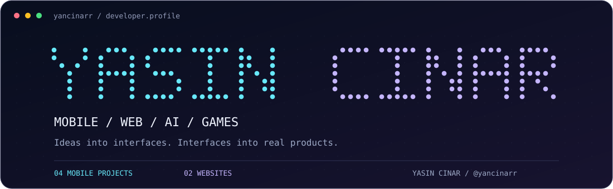

<p align="center">
  
</p>

<div align="center">

### Building things you can tap, play and use.

iOS & Flutter Developer · Web Development · AI-powered Products

**[Portfolio ↗](https://cinarvision.com)** &nbsp; / &nbsp; **[Odanlı Ticaret ↗](https://odanlticaret.com)** &nbsp; / &nbsp; **[Explore my work ↓](#selected-work)**

</div>

## About me

I'm **Yasin Cinar**, a developer with a Computer Engineering background at **Atılım University**. I bring ideas to life through mobile applications, websites and games — with a focus on useful features, thoughtful interfaces and the details that make a product feel good to use.

```text
> whoami
  Yasin Cinar / @yancinarr

> building
  AI communication tools · dual-camera experiences
  daily companions · pixel games · business websites
```

## My toolkit

<p align="center">
  
  
  
  
  
  <br />
  
  
  
  
</p>

**Languages** &nbsp; JavaScript · C# · Dart · Swift  
**Mobile & experiences** &nbsp; Flutter · SwiftUI · AVFoundation · SpriteKit · WidgetKit  
**Data & backend** &nbsp; PostgreSQL · Supabase

## Selected work

<table>
<tr>
<td width="50%" valign="top">
<a href="https://github.com/yancinarr/hizlicevap"></a>
<h3>HızlıCevap · İlişki Hakemi</h3>
<p>An AI-assisted communication app that turns conversation screenshots into context analysis and reply suggestions.</p>
<p><code>Flutter</code> <code>Dart</code> <code>Supabase</code> <code>AI</code></p>
<a href="https://github.com/yancinarr/hizlicevap"><b>Explore the project →</b></a>
</td>
<td width="50%" valign="top">
<a href="https://github.com/yancinarr/pivotcam"></a>
<h3>PivotCam</h3>
<p>Two perspectives, one story. A native iOS dual-camera experience with interactive picture-in-picture controls.</p>
<p><code>Swift</code> <code>SwiftUI</code> <code>AVFoundation</code></p>
<a href="https://github.com/yancinarr/pivotcam"><b>Explore the project →</b></a>
</td>
</tr>
<tr>
<td width="50%" valign="top">
<a href="https://github.com/yancinarr/manevi-seyir-mizan"></a>
<h3>Manevi Seyir · Mizan</h3>
<p>A daily spiritual companion combining habit tracking, prayer times, a Qibla compass and home screen widgets.</p>
<p><code>SwiftUI</code> <code>SwiftData</code> <code>WidgetKit</code></p>
<a href="https://github.com/yancinarr/manevi-seyir-mizan"><b>Explore the project →</b></a>
</td>
<td width="50%" valign="top">
<a href="https://github.com/yancinarr/kul-kosusu"></a>
<h3>Kül Koşusu</h3>
<p>A pixel endless runner inspired by Turkish neighborhood life, with responsive gestures, street events and playful visual effects.</p>
<p><code>Swift</code> <code>SpriteKit</code> <code>SwiftUI</code></p>
<a href="https://github.com/yancinarr/kul-kosusu"><b>Explore the project →</b></a>
</td>
</tr>
</table>

## Beyond mobile

| Website | My work |
| :--- | :--- |
| **[CinarVision ↗](https://cinarvision.com)** | A creative portfolio for video, design and visual storytelling. |
| **[Odanlı Ticaret ↗](https://odanlticaret.com)** | A business website designed and developed for the company. |

---

<div align="center">

**Curious about something I built? Start with a project above.**

<sub>These repositories present selected project showcases and source excerpts. Production credentials, user data and private application code are excluded.</sub>

</div>
